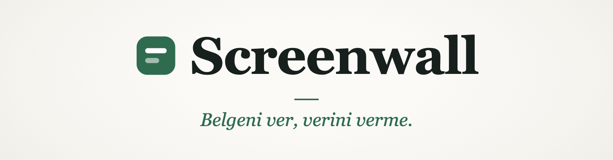

<div align="center">



[](docs/TESTING.md)
[](#testler-neyi-test-ediyor)
[](backend/pyproject.toml)
[](#indir)


[46 saniyelik tanıtım videosu](screenwall-promo.mp4) · [Yatırımcı sunumu (PPTX)](Screenwall-Yatirimci-Sunum.pptx)

</div>

---

<a id="indir"></a>

## İndir

| Sistem | İndir | Durum |
|---|---|---|
| macOS 14 (Sonoma) veya üstü, Apple Silicon ve Intel | [Screenwall-macOS.zip](https://github.com/EminKolac/screenwall/releases/latest/download/Screenwall-macOS.zip) | Bir Apple Silicon Mac'te (macOS 26) zip açılıp başlatıcı terminalden çalıştırılarak uçtan uca denendi. Ayrıca her sürüm, GitHub'ın Apple Silicon ve Intel macOS sunucularında otomatik açılış testinden (CI smoke testi: zip açılır, başlatıcı çalışır, örnek bir belge yüklenip maskelenir; Ollama olmadan) geçer; bu test iki sunucuda da geçmezse sürüm oluşmaz. Finder'dan çift tıklama, internetten indirilmiş zip, macOS 14–15 ve gerçek bir Intel Mac henüz elle denenmedi; Intel'de Ollama ile denetim ve onay hiç denenmedi (bkz. Gerekenler). |
| Tüm sürümler ve SHA256 değerleri | [github.com/EminKolac/screenwall/releases](https://github.com/EminKolac/screenwall/releases) | |

İlk sürüm (v0.1.0) yayımlanana kadar zip bağlantısı ve aşağıdaki kurulum komutu 404 hatası verir.

Screenwall yalnız macOS için yayımlanıyor; Windows desteklenmiyor.

Terminalden kurmak isterseniz (zip'i indirir, SHA256SUMS.txt ile doğrular, `~/Screenwall`
klasörüne kurar ve başlatır):

```sh
curl -LsSf https://github.com/EminKolac/screenwall/releases/latest/download/install-macos.sh | sh
```

### Gerekenler

- **Ollama ve qwen3.5:4b modeli: zorunlu.** Belgeyi onaylayan yerel denetçi bu model.
  Ollama yoksa uygulama açılır ve belgeleri maskeler, ama hiçbir belge onaylanamaz,
  indirilemez ve üzerinde sohbet edilemez. Ollama'yı [ollama.com/download](https://ollama.com/download)
  adresinden kurun. Model yaklaşık 3,4 GB; Ollama kuruluysa başlatıcı onu ilk açılışta kendisi
  indirir ve ilerlemeyi pencerede gösterir.
- Ollama'nın kendi sistem gereksinimi: macOS 14 (Sonoma) veya üstü. Intel Mac'lerde Ollama
  yalnızca işlemciyle (CPU) çalışır, denetim daha yavaş olur. Denetçi bir belgeye en fazla
  120 saniye ayırır; süre aşılırsa belge incelemede kalır. Elle onay da denetimi yeniden
  çalıştırdığı için süreyi hep aşan bir belge onaylanamaz. Intel'de bu sürenin yetip yetmediği
  ölçülmedi: Intel için tek test, Ollama'sız otomatik açılış testi; Intel'de Ollama ile onay
  hiç denenmedi.
- **İlk açılışta internet.** Başlatıcı gerekirse `uv`'yi, Python 3.12'yi ve paketleri bir kez
  indirir: yaklaşık 100 MB indirme, diskte birkaç yüz MB (Python ortamı yaklaşık 250 MB).
- **Tesseract: isteğe bağlı.** Yalnızca taranmış (resim olarak kaydedilmiş) PDF sayfaları için
  gerekir: `brew install tesseract tesseract-lang`. Yoksa taranmış sayfalar okunmaz ve belge
  sizin incelemenize düşer.

### İlk açılış

1. Zip'i açın, `Screenwall` klasöründeki `Screenwall.command` dosyasına çift tıklayın.
2. Bir Terminal penceresi açılır ve uygulama çalıştığı sürece açık kalır.
3. Hazır olunca tarayıcıda `http://127.0.0.1:8765` kendiliğinden açılır.

Süreler (Apple Silicon bir Mac'te ölçüldü; paketler önbellekteydi, indirme süresi dahil değil):
ilk açılış 29–33 saniye, sonraki açılışlar yaklaşık 4 saniye. Temiz bir bilgisayarda indirme
süresi ve model indirmesi (3,4 GB) buna eklenir. Başlatıcı sunucuyu en fazla 90 saniye bekler;
ilk açılışta bu yetmezse uygulamayı bir kez daha başlatın.

Uygulama imzasız olduğu için macOS ilk açılışta uyarı verebilir. Dosyaya sağ tıklayın (ya da
Control tuşuyla tıklayın) > Aç > Aç. macOS 15 (Sequoia) ve sonrasında bu yol çalışmazsa uyarıyı
kapatın, Sistem Ayarları > Gizlilik ve Güvenlik bölümünde Screenwall.command satırındaki
"Yine de Aç" düğmesine basın. Bu yalnızca ilk açılışta gerekir.

Bu adımlar gerçek bir Mac'te tek tek tıklanarak henüz doğrulanmadı.

### Verileriniz nerede, nasıl durdurulur?

- Veri klasörü: `~/Library/Application Support/Screenwall`. İçinde `data` (yüklenen belgeler,
  maskeli kopyalar, kararlarınız), `venv` (Python ortamı) ve `logs` (çalışma kayıtları) var.
  Başka bir klasör için `SCREENWALL_HOME`, başka bir port için `SCREENWALL_PORT` ortam
  değişkenini ayarlayın.
- Durdurmak için pencerede Ctrl+C'ye basın ya da pencereyi kapatın. Ollama ayrı bir programdır
  ve arka planda çalışmaya devam eder; isterseniz kendi menüsünden kapatın.
- Tarayıcıdaki adresin sonundaki `#k=…`, bu açılışa özel bir anahtar; sayfa onu okuyup adres
  çubuğundan kaldırıyor. Anahtar olmadan bu bilgisayardaki başka bir kullanıcı hesabı uygulamaya
  bağlanamıyor. Sizin hesabınızda çalışan programlar ise veri klasörünü zaten okuyabiliyor; bu
  anahtar onlara karşı koruma değil. Uygulamayı her zaman başlatıcıdan açın: yer imindeki adres,
  uygulama yeniden başladıktan sonra çalışmaz.
- Kaldırma adımları ve ayrıntılar zip içindeki `OKU-BENI.txt` dosyasında.

## Bu ne işe yarıyor?

Bir sözleşmeyi ya da bordroyu ChatGPT'ye yapıştırdığınızda içindeki TC kimlik numaraları,
adlar, IBAN'lar da gidiyor ve geri alma şansınız yok. Screenwall bunun önüne geçmek için
yazıldı: belge kendi bilgisayarınızda taranıyor, kişisel veriler `<PERSON_1>` gibi etiketlerle
değiştiriliyor ve dışarıya yalnızca bu maskelenmiş kopya çıkıyor.

Sistemin bir huyu var, bilerek böyle: emin olamadığı belgeyi onaylamıyor, size soruyor.
Yanlışlıkla bir şey maskelediyse de inceleme ekranında tek tıkla geri alabiliyorsunuz
(varsayılan "Takma ad" modunda; orijinali hiç saklamayan "Geri döndürülemez" modda bu mümkün
değil).

PDF, Word ve Excel destekleniyor; tablolar, üstbilgi/altbilgiler, hücre açıklamaları ve
taranmış sayfalar (OCR ile) dahil. Türkçe için ayrıca uğraştık: TCKN checksum doğrulaması,
GSM/IBAN/plaka kalıpları, sağlık ve engellilik ifadeleri, İ/ı büyük-küçük harf tuzakları.

## Nasıl çalışıyor?

1. **Yükleme.** Dosya türü ve boyutu denetleniyor, metin yapısı korunarak çıkarılıyor, dil
   (Türkçe, İngilizce, karışık) belirleniyor. Belge makinenizden çıkmıyor.
2. **Tek tespit geçişi.** Presidio ve spaCy ile bu repodaki Türkçe tanıyıcılar birlikte
   çalışıyor; bulunan kişisel veriler etiketlerle değiştiriliyor.
3. **Yerel denetim.** Maskeli kopyayı iki denetçi okuyor: kural tabanlı bir kontrol ve Ollama
   üzerinde çalışan Qwen 3.5 4B. İkisinin de temiz demesi gerekiyor.
4. **En fazla bir onarım turu.** Denetçi açıkta kalan bir değer bulursa o değer maskelenip belge
   bir kez daha denetleniyor.
5. **Onay ya da inceleme.** Belge yalnızca Qwen gerçekten çalıştıysa, denetim temizse ve açık
   bir madde kalmadıysa otomatik onaylanıyor. Aksi halde nedenleriyle birlikte sizin
   incelemenize düşüyor. Elle onaylarken, belgenin son hâli Qwen'den geçmediyse önce yeniden
   denetleniyor; Ollama çalışmıyorsa onay verilmiyor.
6. **Onaydan sonra.** Maskeli metinden yeni bir PDF üretilip indiriliyor; orijinal dosyanın
   görseli, üst verisi ya da yorumu bu PDF'e taşınmıyor. Belge üzerinde soru da sorabiliyorsunuz.
   Sohbet yalnızca maskeli metni okuyor. Varsayılan sağlayıcı yerel Ollama. İsterseniz kendi
   Claude Code ya da Codex CLI oturumunuzla bulut sohbeti de seçebilirsiniz. Screenwall API
   anahtarı saklamıyor. Bulut sağlayıcıya giden her soruda, gidecek metnin tamamı önce size
   gösteriliyor ve onayınız olmadan hiçbir şey gönderilmiyor. Her gönderim, içeriği olmadan
   (zaman, sağlayıcı, belge kimliği, boyut) yerel bir kayda yazılıyor.

```
Yükle ─▶ Doğrula ─▶ Çıkar ─▶ Tespit + maskele ─▶ Denetim (kurallar + yerel Qwen)
                                    ▲                       │
                                    └─ onarım turu (en fazla 1) ◀─ kalıntı var
Denetim temiz, Qwen çalıştı, açık madde yok ─▶ ONAYLANDI ─▶ PDF indir · sohbet (maskeli metin)
Aksi halde ─▶ İNCELEMEDE: siz karar verirsiniz; onay öncesi Qwen yeniden denetler
```

## Bilinen sınırlar

Bunlar ölçülmüş ya da sentetik örneklerle gösterilmiş sorunlar. Belgeyi dışarı vermeden önce
özellikle bu noktalara bakın.

| Sınır | Ne oluyor |
|---|---|
| Cümle içinde büyük harfle yazılmış adlar | "Toplantıya genel müdürü DENEME ÖRNEKOĞLU katıldı." gibi bir cümlede ad maskelenmeyebiliyor. 6 Ekim değerlendirmesinde canlı denetçi, adlar açıkta kaldığı halde böyle bir paragrafı onayladı. "Adı Soyadı:" gibi etiketli alanlardaki adlar maskeleniyor. |
| Resmî adres biçimleri | "MAH. … SK. NO: x / NO: y İLÇE / İL" ve "DIŞ KAPI NO … İÇ KAPI NO …" biçimleri 7 Ekim'den beri sentetik örneklerde bütün olarak maskeleniyor; gerçek bir e-Devlet PDF'inden çıkan metinle yeniden denenmedi. Bu kural mahalle/sokak kısaltması (MAH., SK., CAD., BLV. ya da açık yazılışı) ve kapı numarası olmayan adresleri görmüyor. |
| Yarı-tanımlayıcılar | Meslek, eğitim, sendika üyeliği, hukuki durum ve maaş bilgisi otomatik onaydan sonra da metinde kalabiliyor; denetçi bu türlere bakmıyor. Katı ölçümde maskelenen: meslek 0/40, eğitim 0/20, sendika 0/10, hukuki durum 0/10, maaş 16/20. |
| İş terimlerinin gereksiz maskelenmesi | "Vergi Usul Kanunu", "Dönem Karı" gibi terimler kişi ya da yer sanılıp maskeleniyor. Listesiz ölçümde korunması gereken 90 terimin yalnızca 10'u korunuyor; kişisel veri içermeyen 40 sıradan cümlenin 11'i değiştiriliyor. |
| Henüz mühürlü test seti yok | %100 sonuçlar, kural ayarında da kullanılmış 60 belgelik geliştirme setinden geliyor. Sistemin hiç görmediği belgelerdeki başarı henüz ölçülmedi. |
| Windows desteklenmiyor (yalnız macOS) | Hazır paket yalnız macOS için (Apple Silicon ve Intel). Windows için paket yok ve Windows'ta test koşulmuyor. |

Elle düzeltmek için: inceleme ekranında metni seçip maskeleyebilir, sürekli maskelenmesi
gereken adları Ayarlar'daki "Her zaman maskele" listesine yazabilirsiniz.

## Hangi teknolojiler kullanılıyor?

| Katman | Ne kullandık | Ne için |
|---|---|---|
| Tespit | [Microsoft Presidio](https://microsoft.github.io/presidio/) + [spaCy](https://spacy.io) (`en_core_web_sm`, çok dilli `xx_ent_wiki_sm`) | Kural ve istatistik tabanlı kişisel veri tespiti |
| Türkçe tanıyıcılar | 17 özel tanıyıcı, 15 veri türü (bu repoda; ayrıca 4 İngilizce tanıyıcı) | TCKN, VKN, IBAN, GSM, plaka, pasaport, adres, maaş bandı, sağlık/engellilik, etiketli ad alanları… Presidio'nun Türkçe'de göremediklerini kapatıyor |
| Denetçi | Qwen 3.5 4B ([Ollama](https://ollama.com) üzerinden, yerel, zorunlu) + kural tabanlı kontrol | Maskelenmiş kopyada kalıntı var mı diye ikinci göz |
| Belge işleme | PyMuPDF, python-docx, openpyxl, Tesseract (OCR, isteğe bağlı) | PDF/DOCX/XLSX okuma, taranmış sayfa metni, PDF üretimi |
| Sohbet (isteğe bağlı) | Ollama (yerel) ya da kendi Claude Code / Codex CLI oturumunuz (bulut) | Onaylı belgeye soru sormak; bulutta her soru önizleme ve onay ister |
| Backend | Python 3.12, FastAPI, uv | API ve işlem hattı |
| Arayüz | React 18 + Vite + TypeScript | Yükleme, inceleme, geri alma, sohbet ekranları |

Tespit ve denetim bu bilgisayarda yapılıyor. Belge içeriği bu bilgisayardan yalnızca bir yolla
çıkabiliyor: onaylı belgenin maskeli metni, bulut sohbetini seçip her soruyu ayrıca
onayladığınızda. İnternet bağlantısı bunun dışında ilk kurulumda (paketler ve model) gerekiyor.

## Testler neyi test ediyor?

Bu bölümü biraz uzun tuttuk çünkü "%100 başarı" tek başına bir şey ifade etmiyor;
neyin üzerinde ölçüldüğünü bilmek gerekiyor.

### Test belgeleri (korpus) nereden geliyor?

Gerçek insanların belgelerini test için kullanamayız; bu yüzden **240 sentetik belge**
ürettik. Sentetik ama gelişigüzel değil: altı gerçek belge türünü taklit ediyorlar:
iş sözleşmesi, İK özlük dosyası, sağlık raporu, banka yazışması, kamu dilekçesi ve müşteri
e-postası. İçlerindeki kişiler, TCKN'ler (checksum'ı tutan sahte numaralar), adresler,
tanılar üretici tarafından yerleştiriliyor ve **her birinin yeri önceden işaretli**. Yani
elimizde cevap anahtarı var: sistem belgeyi tarayınca neyi bulup neyi kaçırdığını kesin
olarak sayabiliyoruz.

Bu 240 belgenin 60'ı ayrı tutulan bir sınav bölümüydü. Okuldaki deneme sınavı / gerçek
sınav ayrımı gibi: sistem soruları ezberlemiş mi, gerçekten öğrenmiş mi, bunu ancak hiç
görmediği belgeler söyler. Dürüst olmak gerekirse o 60 belge önceki çalışmalarda kural ayarlamak
için de kullanıldı; artık "geliştirme seti" sayılıyor. Yerine farklı şablonlar, farklı isimler ve
farklı iş terimleriyle, kuralları yazan modelden bağımsız hazırlanacak yeni bir mühürlü set
planlanıyor; henüz yok.

### Testlerin gerçek hayattaki karşılığı

| Test | Gerçek iş ortamında neye denk geliyor | Sonuç |
|---|---|---|
| Stres testi (72 belge) | Ofiste her gün olan kazalar: telefon numarası Excel'de iki hücreye bölünmüş, TCKN sayfanın altbilgisinde, sözleşme taranmış fotoğraf olarak gelmiş, biri bozuk dosya yollamış, Excel'de gizli sayfa unutulmuş. Bu belgeleri bilerek bu şekilde hazırlayıp canlı denetçiyle sisteme verdik. | Onaylı çıktıya sızıntı: **0/72**. Güvenli belgelerin **59/62**'si otomatik onaylandı, 3'ü incelemeye gitti. |
| Kritik veri yakalama | Ad soyad, TCKN, IBAN, kart, telefon, e-posta, adres, sağlık ve engellilik bilgisi. Ölçüm 60 belgelik geliştirme setinde yapıldı; sistemin bu belgeleri daha önce gördüğünü unutmayın. | **1555/1555*** |
| Belgenin işe yararlığı | Maskelenmiş belgeyi avukatınıza ya da yapay zekâya verdiğinizde işinize yarıyor mu? Belgelere 280 gerçekçi soru sorduk ("ceza koşulu ne kadar?", "hangi tarihte teslim?") ve maskelemeden sonra kaçının hâlâ cevaplanabildiğini saydık. 7 Ekim 2026'da, denetçi LLM kapalıyken ölçüldü. | Terim listesi olmadan **%63,2** (177/280). Uygulamanın varsayılan Türkçe izin listesiyle %91,8 (257/280)** |
| Sahte kimlik denemesi | Belgelere 16 sahte kimlik, hesap numarası ve API anahtarı sakladık ve her birini iki biçimde (yalın ve etiketli) denedik. Madencilerin kanaryası gibi bir erken uyarı düzeneği: bir gün biri kaçarsa ilk buradan görürüz. | Kaçak: **0/32** |
| Gereksiz karartma denemesi | Madalyonun öteki yüzü: içinde hiç kişisel veri olmayan 40 sıradan iş cümlesi verdik ("Faaliyet raporu bağımsız denetimden geçmiştir." gibi). İyi bir sistem bunlara dokunmamalı. Bizimki 40 cümlenin 11'inde gereksiz karartma yaptı; bu bilinen kusurumuz, aşağıda yol haritasında. | 11/40 hata |

\* Fable'ın kendi puanlayıcısıyla 60 belgenin tamamında, listeler kapalı. Screenwall V2'nin daha
katı puanlayıcısıyla aynı belgelerde 472/489 (%96,5). Bu puanlayıcı, değerin en az 3 harflik bir
parçası açıkta kalsa bile kaçak sayıyor; 17 kaçağın 16'sı böyle kısmi kaçaklar.

\*\* İzin listesi, korunması gereken iş terimlerini içeriyor; aradaki 80 sorunun hepsini bu liste
kurtarıyor. Bu yüzden %91,8'i iyimser sayıyoruz. Bu tabloda önceden yazan %98,9, Ağustos 2026'da
eski kodla ve liste açıkken ölçülmüştü; artık kullanmıyoruz.

Bütün sayılar, tarihleri ve nasıl ölçüldükleri: [`docs/SCORECARD.md`](docs/SCORECARD.md).

### Aynı sınav, iki sürüm

Aynı ürünün iki sürümü var: bu repo **Claude** ile, ikinci sürüm **ChatGPT (Codex)** ile
geliştirildi. İkisi birbirinden bağımsız değil. İkinci sürüm 22 Eylül 2026'da bu reponun bir
kopyası (fork) olarak başladı, aynı gün tespit motorunu kendi motoruyla değiştirdi ve ondan sonra
ayrı geliştirildi. Kendi puanlayıcımızla kendimize not vermiş olmayalım diye iki sürüm, ChatGPT
sürümünün puanlayıcısıyla ve onun kıyas korpusundaki aynı belgelerle koşuldu:

| Test | Screenwall Claude | Screenwall ChatGPT |
|---|---|---|
| Kritik veri yakalama (katı puanlayıcı) | 472/489 | 438/489 |
| Sahte kimlik kaçağı (düşük iyi) | 0/32 | 7/32 |
| Stres testi sızıntısı (canlı denetçi) | 0/72 | 0/72 |
| Güvenli belgenin teslimi | 59/62 | 28/62 |
| Korunması gereken iş terimleri (yüksek iyi) | 10/90 | 38/90 |
| Gereksiz karartma denemesi (düşük iyi) | 11/40 | 21/40 |

Tablo, iki sürümün aynı puanlayıcıyla (ChatGPT sürümünün kendi puanlayıcısı) ve ikisi de
hiçbir terim listesi olmadan çalıştırıldığı ölçümden geliyor. Claude sütunu bu repodaki skor
kartıyla üretildi, ama yeniden üretmek için V2 kıyas korpusu (`~/bist10-benchmark`, başka bir
yer için `FABLE_BENCH_CORPUS`) gerekiyor ve bu korpus repoda yok (aşağıda "Ölçümleri kendiniz
koşun"). ChatGPT sütunu o sürümün kendi ölçümünden alındı ve ham çıktısı bu repoda yok. Bu
tablonun önceki hâlinde "Gereksiz karartma" satırında iki sürüm için de 0/90 yazıyordu. O sayı
bizim tarafta ölçülen 90 terimin hepsini içeren bir izin listesinden geliyordu, yani bir test
sızıntısıydı. Listesiz dürüst sayı yukarıdaki 10/90. Korunması gereken terimlerde iki sürüm de
zayıf; bu, şu anki çalışmanın ana hedefi. Deney günlüğünün tamamı (başarısız denemeler dahil)
[`thoughts/EXPERIMENTS.md`](thoughts/EXPERIMENTS.md) dosyasında.

## Kaynaktan çalıştırma (geliştirici)

Gerekenler: [uv](https://docs.astral.sh/uv/), Node.js 18 veya üstü, Ollama ve `qwen3.5:4b`.
spaCy modelleri `uv sync` ile birlikte kuruluyor; ayrıca indirmeye gerek yok.

```bash
git clone https://github.com/EminKolac/screenwall.git && cd screenwall
cd backend && uv sync && cd ..
cd frontend && npm install && cd ..
ollama pull qwen3.5:4b

bash start.sh      # Ollama + backend (127.0.0.1:8000) + arayüz (127.0.0.1:5174)
bash stop.sh       # backend ve arayüzü durdurur; Ollama açık kalır
```

Tarayıcıda `http://localhost:5174`. Ayarlar, tek sunuculu paket modu ve sürüm paketleri
(`make release`): [`docs/DEPLOYMENT.md`](docs/DEPLOYMENT.md). Testler: `make test`
(ayrıntı: [`docs/TESTING.md`](docs/TESTING.md)).

## Ölçümleri kendiniz koşun

Yayımlanan sayıların çoğu skor kartından geliyor (fayda ölçümü ayrı bir komut, aşağıda):

```bash
make scorecard        # hızlı: denetçi LLM kapalı, gerçek belge yok
make scorecard-full   # tam: canlı Qwen 3.5 4B + 30 gerçek BIST PDF'i (~1,5 saat)
```

Canlı denetçiye bağlı sayılar (stres testinde 59/62 güvenli teslim gibi) yalnızca
`make scorecard-full` ile üretilir; hızlı skor kartı bunları ölçmez. Tam skor kartının üç ön
koşulu var:

- Ollama çalışıyor ve `qwen3.5:4b` kurulu olmalı.
- Katı puanlayıcı ve stres bölümleri V2 kıyas korpusunu ister: `~/bist10-benchmark` klasörü
  (başka bir yer için `FABLE_BENCH_CORPUS`). Bu klasör repoda yok.
- Gerçek belge bölümü `backend/data/corpus_bist10/raw` altındaki BIST PDF'lerini ister; bunlar da
  repoda yok.

Yani temiz bir klonda `make scorecard` da `make scorecard-full` da tamamlanmaz: katı puanlayıcı
(472/489, 0/32 kanarya, 10/90, 11/40) ve skor kartının stres bölümü bu repodan yeniden
üretilemez. Temiz bir klonda çalışanlar:

```bash
cd backend
# Fable puanlayıcısı, 60 belge (1555/1555)
uv run python -m evaluation.scorecard --sections gold --tag benim
# stres testi; korpusu kendisi üretir. 59/62 için Ollama açıkken --llm on ekleyin
uv run python -m evaluation.goldbench.run_stress --mode mapping --tag benim
# fayda, 280 soru (TERM_LISTS=false ile listesiz)
uv run python -m evaluation.goldbench.run_inference --mode mapping --tag benim
# ayrı bir kanarya kataloğuyla hızlı ölçüm (skor kartındaki 0/32 ile aynı ölçüm değil)
uv run python scripts/measure_canary.py
```

## Yol haritası

- İlk sürümü (v0.1.0) yayımlamak
- macOS'ta henüz elle denenmeyenleri denemek: Finder'dan çift tıklama ve ilk açılış uyarısı,
  internetten indirilmiş zip, macOS 14–15 ve gerçek bir Intel Mac (Ollama ile onay süresi
  dahil). Windows sürümü şimdilik planda yok.
- Büyük harfle yazılmış adlar, kısaltmasız resmî adresler ve yarı-tanımlayıcılar (yukarıdaki
  "Bilinen sınırlar")
- Gereksiz karartmayı dürüst ölçümle indirmek: nötr cümlede 11/40'tan en fazla 2/40'a,
  korunması gereken iş terimlerinde 10/90'dan en az 80/90'a (listesiz; bkz. docs/SCORECARD.md)
- Bağımsız, mühürlü bir test seti
- UYAP UDF desteği: avukatların gerçekte kullandığı format
- Saldırı-direnci (TRIR) testi: paketi hazır, henüz koşulmadı; koşulmadığı sürece
  raporlarda "ölçülmedi" olarak geçiyor, geçer not saymıyoruz

## Lisans

Henüz lisans seçmedik. Kod incelemeye açık; yeniden kullanım izni lisans eklenene kadar saklı.
