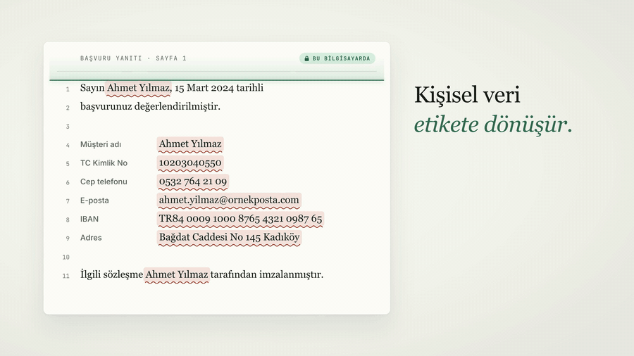

<div align="center">

# Screenwall

**Önce maskele. Sonra sor.**

[](docs/TESTING.md)
[](#test-sonuclari)
[](backend/pyproject.toml)
[](#indir)
[](LICENSE)

</div>

Screenwall, sözleşme, bordro ya da rapor gibi şirket dokümanlarındaki müşteri ve kişi adlarını,
kimlik ve vergi numaralarını, IBAN'ları ve benzeri hassas bilgileri kendi bilgisayarınızda bulup
`<ORG_1>`, `<PERSON_1>`, `<IBAN_1>` gibi etiketlerle değiştiren bir macOS uygulaması.
Bir belgeyi Claude ya da ChatGPT'ye yapıştırdığınızda içindeki hassas bilgiler de gider ve geri
alınamaz; Screenwall bu yüzden önce maskeler, maskeli kopyayı lokal bir LLM ile denetler ve emin
olamadığında kararı size bırakır.
Gerçek değerler bilgisayarınızda kalır; dışarıya yalnızca etiketli metin çıkar, o da siz bulut
sohbetini seçip her soruyu ayrıca onayladığınızda.

**Tanıtım filmi (50 saniye):** [screenwall-promo.mp4](screenwall-promo.mp4). Filmde kurumsal bir
tedarik sözleşmesi bilgisayarda maskeleniyor, iki adımlı denetimden geçiyor (kurallar ve Ollama
üzerinde çalışan lokal LLM, Qwen 3.5 4B), son kararı kullanıcı veriyor ve Claude ya da ChatGPT'ye
yalnızca etiketler gidiyor. Sunum: [Screenwall-Yatirimci-Sunum.pptx](Screenwall-Yatirimci-Sunum.pptx).
Site: [screenwall.site](https://screenwall.site) (kaynağı repodaki `site/` klasörü).

<div align="center">



</div>

---

<a id="indir"></a>

## İndir

macOS 14 (Sonoma) veya üstü; Apple Silicon ve Intel. Windows desteklenmiyor.

| Dosya | Ne için |
|---|---|
| [**Screenwall-macOS.dmg**](https://github.com/EminKolac/screenwall/releases/latest/download/Screenwall-macOS.dmg) | Önerilen: sürükle-bırak kurulum |
| [Screenwall-macOS.zip](https://github.com/EminKolac/screenwall/releases/latest/download/Screenwall-macOS.zip) | Aynı uygulama, klasör olarak (başlatıcı: `Screenwall.command`) |
| [install-macos.sh](https://github.com/EminKolac/screenwall/releases/latest/download/install-macos.sh) | Terminalden tek komutla kurulum (aşağıda) |
| [SHA256SUMS.txt](https://github.com/EminKolac/screenwall/releases/latest/download/SHA256SUMS.txt) | Üç dosyanın SHA256 değerleri |

Bütün sürümler ve notları: [github.com/EminKolac/screenwall/releases](https://github.com/EminKolac/screenwall/releases).
İndirdiğiniz dosyayı doğrulamak için, `SHA256SUMS.txt` ile aynı klasörde:
`shasum -a 256 -c SHA256SUMS.txt --ignore-missing`.

### DMG ile kurulum

1. `Screenwall-macOS.dmg` dosyasını açın.
2. Açılan pencerede `Screenwall` simgesini `Applications` klasörüne sürükleyin. Aynı pencerede
   `OKU-BENI.txt` de var.
3. İlk açılış: Uygulamalar klasöründe Screenwall'a sağ tıklayın (ya da Control tuşuyla
   tıklayın), sonra **Aç** ve açılan uyarıda yine **Aç**. Screenwall Apple tarafından
   imzalanmadığı için macOS ilk seferde uyarı verir. macOS 15 (Sequoia) ve sonrasında bu yol da
   reddedilirse uyarıyı kapatın, **Sistem Ayarları › Gizlilik ve Güvenlik** bölümünde Screenwall
   satırındaki **Yine de Aç** düğmesine basın. Bu yalnızca ilk açılışta gerekir.
4. Bir Terminal penceresi açılır ve ne yapıldığını adım adım gösterir. İlk açılışta Python ortamı
   hazırlanır: yaklaşık 100 MB indirme, ardından 30 saniye kadar hazırlık. Ollama kuruluysa
   denetçi modeli `qwen3.5:4b` (yaklaşık 3,4 GB) da bu sırada indirilir. macOS ilk açılışta
   "komut satırı geliştirici araçları"nı yüklemeyi önerirse **Vazgeç**'e basın; Screenwall'ın
   bunlara ihtiyacı yok. Terminal'de `Failed to patch the install name` içeren bir uyarı
   çıkarsa o da önemsiz; kurulum devam eder.
5. Hazır olunca tarayıcıda `http://127.0.0.1:8765` kendiliğinden açılır.
6. Durdurmak için Terminal penceresini kapatın ya da pencerede Ctrl+C'ye basın.

Uygulama paketi salt okunur kalır. Belgeler, ayarlar, kayıtlar ve Python ortamı (`venv`)
`~/Library/Application Support/Screenwall` klasöründe durur. uv (kurulu değilse), Python 3.12 ve
indirme önbelleği bu klasörün dışına, `~/.local/bin`, `~/.local/share/uv` ve `~/.cache/uv`
altına kurulur.

### Zip ile ya da terminalden

- **Zip:** zip'i açın, `Screenwall` klasöründeki `Screenwall.command` dosyasına çift tıklayın.
  İlk açılış uyarısı ve sonraki adımlar DMG ile aynı; uyarı bu kez `Screenwall.command` için çıkar.
- **Terminal:** aşağıdaki komut zip'i indirir, `SHA256SUMS.txt` ile doğrular, `~/Screenwall`
  klasörüne kurar ve başlatır. Daha sonra `~/Screenwall/Screenwall.command` ile açarsınız.

```sh
curl -LsSf https://github.com/EminKolac/screenwall/releases/latest/download/install-macos.sh | sh
```

### Gerekenler

- **Ollama ve qwen3.5:4b modeli: zorunlu.** Belgeyi onaylayan denetçi, Ollama üzerinde çalışan
  bu lokal LLM. Ollama yoksa uygulama açılır ve belgeleri maskeler, ama hiçbir belge onaylanamaz, indirilemez
  ve üzerinde sohbet edilemez. Ollama'yı [ollama.com/download](https://ollama.com/download)
  adresinden kurun. Ollama kuruluysa Screenwall modeli ilk açılışta kendisi indirir.
- Ollama macOS 14 (Sonoma) veya üstünü ister. Intel Mac'lerde Ollama yalnızca işlemciyle (CPU)
  çalışır, denetim daha yavaş olur. Denetçi bir belgeye en fazla 120 saniye ayırır; süre aşılırsa
  belge incelemede kalır. Elle onay da denetimi yeniden çalıştırdığı için süreyi hep aşan bir
  belge onaylanamaz. Intel'de bu sürenin yetip yetmediği ölçülmedi.
- **İlk açılışta internet.** `uv`, Python 3.12 ve paketler bir kez indirilir: yaklaşık 100 MB
  indirme, diskte birkaç yüz MB (Python ortamı yaklaşık 250 MB).
- **Tesseract: isteğe bağlı.** Yalnızca taranmış (resim olarak kaydedilmiş) PDF sayfaları için
  gerekir: `brew install tesseract tesseract-lang`. Yoksa taranmış sayfalar okunmaz ve belge
  sizin incelemenize düşer.

Süreler (Apple Silicon bir Mac'te ölçüldü; paketler önbellekteydi, indirme süresi dahil değil):
ilk açılış 29–33 saniye, sonraki açılışlar yaklaşık 4 saniye. Başlatıcı sunucuyu en fazla 90
saniye bekler; ilk açılışta bu yetmezse Screenwall'ı bir kez daha açın.

### Ne denendi, ne denenmedi

Yayımlanan v0.1.0 DMG'sindeki uygulama 11 Ekim 2026'da bir Apple Silicon Mac'te (macOS 26)
Ollama ile uçtan uca denendi. Uygulama `open` komutuyla açıldı; Terminal penceresini açtı, Python
ortamını hazırladı, 65 saniyede çalışır hâle geldi ve Ollama'yı başlattı. Sentetik bir kurumsal
Word belgesinde müşteri `<ORG_1>`, yetkili `<PERSON_1>`, e-posta `<EMAIL_1>`, IBAN `<IBAN_1>`,
VKN `<VKN_1>`, onaylayan kişi `<PERSON_2>` oldu; tutar ve teslim süresi açık kaldı. Lokal LLM
denetimi belgeyi onayladı (ilk denetim, model belleğe yüklenirken 68 saniye). Bir maskeyi geri
alıp yeniden onaylamak denetimi yeniden çalıştırdı (yaklaşık 15 saniye). İndirilen PDF'te gerçek
değerlerin hiçbiri yoktu. Bu denemede görülen iki kusur v0.1.2'de düzeltildi: ilk iki kelimesi
büyük harfle başlayan "Tedarik Sözleşmesi (örnek, sentetik veri)" başlığı İngilizce ad tanıyıcısı
tarafından kişi adı sanılıp maskeleniyordu (artık sözleşme, rapor, fatura gibi bir belge türü adı
içeren bir öbek kişi adı sayılmıyor) ve indirilen PDF'in başlığı İngilizceydi ("Anonymized
Document"; artık "Maskelenmiş belge"). Düzeltilmiş sürüm de aynı yoldan denendi: v0.1.2 DMG'sindeki uygulama `open` ile
açıldı, aynı belgede başlık açık kaldı, öteki alanlar yine maskelendi, lokal LLM belgeyi onayladı
ve indirilen PDF "Maskelenmiş belge" başlığıyla, gerçek değer içermeden geldi.

Zip de aynı Mac'te başlatıcı terminalden çalıştırılarak uçtan uca denendi. Her sürüm ayrıca
GitHub'ın Apple Silicon ve Intel macOS sunucularında otomatik açılış testinden geçer (zip açılır,
başlatıcı çalışır, örnek bir belge yüklenip maskelenir; Ollama olmadan); bu test iki sunucuda da
geçmezse sürüm oluşmaz. Henüz elle denenmeyenler: Finder'dan ilk açılış ve Gatekeeper uyarısı
(tarayıcıyla indirilmiş, karantina işaretli DMG ya da zip; denenen DMG komut satırından
indirilmişti), Xcode komut satırı araçları kurulu olmayan bir Mac, macOS 14–15 ve gerçek bir
Intel Mac. Intel'de Ollama ile denetim ve onay hiç denenmedi.

### Verileriniz nerede, nasıl kaldırılır?

- Veri klasörü: `~/Library/Application Support/Screenwall`. İçinde `data` (yüklenen belgeler,
  maskeli kopyalar, kararlarınız), `venv` (Python ortamı) ve `logs` (çalışma kayıtları) var.
- Ollama ayrı bir programdır; Screenwall'ı durdurduktan sonra arka planda çalışmaya devam eder.
  İsterseniz kendi menüsünden kapatın.
- Tarayıcıdaki adresin sonundaki `#k=…`, bu açılışa özel bir anahtar; sayfa onu okuyup adres
  çubuğundan kaldırıyor. Anahtar olmadan bu bilgisayardaki başka bir kullanıcı hesabı uygulamaya
  bağlanamıyor. Yer imindeki adres, Screenwall yeniden başladıktan sonra çalışmaz; Screenwall'ı
  her zaman uygulamadan (ya da `Screenwall.command` ile) açın.
- Kaldırmak için Screenwall'ı Uygulamalar klasöründen (zip ya da terminal kurulumunda
  `Screenwall` klasörünü) ve veri klasörünü çöp kutusuna taşıyın. Belgeleriniz veri klasöründe;
  gerekirse önce yedekleyin. uv ve Python klasörleri dahil ayrıntılar `OKU-BENI.txt` dosyasında.

## Nasıl çalışıyor?

Sistemin bir huyu var, bilerek böyle: emin olamadığı belgeyi onaylamıyor, size soruyor. Yanlışlıkla
bir şey maskelediyse inceleme ekranında tek tıkla geri alabiliyorsunuz (varsayılan "Takma ad"
modunda; orijinali hiç saklamayan "Geri döndürülemez" modda bu mümkün değil).

PDF, Word ve Excel destekleniyor; tablolar, üstbilgi/altbilgiler, hücre açıklamaları ve taranmış
sayfalar (OCR ile) dahil. Türkçe için ayrıca uğraştık: TCKN checksum doğrulaması, GSM/IBAN/plaka
kalıpları, sağlık ve engellilik ifadeleri, İ/ı büyük-küçük harf tuzakları.

1. **Yükleme.** Dosya türü ve boyutu denetleniyor, metin yapısı korunarak çıkarılıyor, dil
   (Türkçe, İngilizce, karışık) belirleniyor.
2. **Tek tespit geçişi.** Presidio ve spaCy ile bu repodaki Türkçe tanıyıcılar birlikte
   çalışıyor; bulunan kişisel veriler etiketlerle değiştiriliyor. İnceleme ekranında her maskenin
   nedeni yazıyor ("TCKN doğrulandı", "Alan etiketi ve ad" gibi).
3. **Yerel denetim.** Maskeli kopyayı iki denetçi okuyor: kural tabanlı bir kontrol ve lokal LLM
   (Ollama üzerinde çalışan Qwen 3.5 4B). İkisinin de temiz demesi gerekiyor.
4. **En fazla bir onarım turu.** Denetçi açıkta kalan bir değer bulursa o değer maskelenip belge
   bir kez daha denetleniyor.
5. **Onay ya da inceleme.** Belge yalnızca lokal LLM gerçekten çalıştıysa, denetim temizse ve açık
   bir madde kalmadıysa otomatik onaylanıyor. Aksi halde nedenleriyle birlikte sizin
   incelemenize düşüyor. Elle onaylarken, belgenin son hâli lokal LLM'den geçmediyse önce yeniden
   denetleniyor; Ollama çalışmıyorsa onay verilmiyor.
6. **Onaydan sonra.** Maskeli metinden yeni bir PDF üretilip indiriliyor. Belge üzerinde soru da
   sorabiliyorsunuz; sohbet yalnızca maskeli metni okuyor. Varsayılan sağlayıcı lokal LLM
   (Ollama). İsterseniz bulut sohbetini seçebilirsiniz: Claude için kendi Claude Code CLI
   oturumunuz, ChatGPT için ChatGPT hesabınızla giriş yaptığınız Codex CLI kullanılıyor.

```
Yükle ─▶ Doğrula ─▶ Çıkar ─▶ Tespit + maskele ─▶ Denetim (kurallar + lokal LLM)
                                    ▲                       │
                                    └─ onarım turu (en fazla 1) ◀─ kalıntı var
Denetim temiz, lokal LLM çalıştı, açık madde yok ─▶ ONAYLANDI ─▶ PDF indir · sohbet (maskeli metin)
Aksi halde ─▶ İNCELEMEDE: siz karar verirsiniz; onay öncesi lokal LLM yeniden denetler
```

### Kullanılan teknolojiler

| Katman | Ne kullandık | Ne için |
|---|---|---|
| Tespit | [Microsoft Presidio](https://microsoft.github.io/presidio/) + [spaCy](https://spacy.io) (`en_core_web_sm`, çok dilli `xx_ent_wiki_sm`) | Kural ve istatistik tabanlı kişisel veri tespiti |
| Türkçe tanıyıcılar | 17 özel tanıyıcı, 15 veri türü (bu repoda; ayrıca 4 İngilizce tanıyıcı) | TCKN, VKN, IBAN, GSM, plaka, pasaport, adres, maaş bandı, sağlık/engellilik, etiketli ad alanları… Presidio'nun Türkçe'de göremediklerini kapatıyor |
| Denetçi | Lokal LLM: Qwen 3.5 4B ([Ollama](https://ollama.com) üzerinden, zorunlu) + kural tabanlı kontrol | Maskelenmiş kopyada kalıntı var mı diye ikinci göz |
| Belge işleme | PyMuPDF, python-docx, openpyxl, Tesseract (OCR, isteğe bağlı) | PDF/DOCX/XLSX okuma, taranmış sayfa metni, PDF üretimi |
| Sohbet (isteğe bağlı) | Lokal LLM (Ollama) ya da bulutta Claude (Claude Code CLI) ve ChatGPT (Codex CLI), kendi oturumunuzla | Onaylı belgeye soru sormak; bulutta her soru önizleme ve onay ister |
| Backend | Python 3.12, FastAPI, uv | API ve işlem hattı |
| Arayüz | React 18 + Vite + TypeScript | Yükleme, inceleme, geri alma, sohbet ekranları |

## Gizlilik: ne bilgisayarda kalır, ne çıkabilir?

**Bilgisayarınızda kalanlar**

- Orijinal belge, maskeli kopya, hangi etiketin hangi gerçek değere karşılık geldiği ve
  kararlarınız. Hepsi veri klasöründe, yalnız sizin kullanıcı hesabınızın okuyabileceği
  izinlerle. "Geri döndürülemez" modda orijinal metin ve etiket eşlemesi diske hiç yazılmaz.
- Tespit, maskeleme ve denetim. Denetçi LLM de bu bilgisayarda çalışır (Ollama). Screenwall
  başka bir bilgisayardaki Ollama'ya, ayarla açıkça izin verilmedikçe bağlanmaz; Ollama'nın bulut
  modellerini hiç kullanmaz.
- Tarayıcıyla uygulama arasındaki trafik. Sunucu yalnız `127.0.0.1` adresinde dinler; ağdaki
  başka bir cihaz bağlanamaz.
- İndirdiğiniz PDF yalnız maskeli metinden üretilir; orijinal dosyanın görselleri, üst verisi ve
  yorumları ona taşınmaz.

**Dışarı çıkabilenler, yalnız sizin onayınızla**

- Bulut sohbetini (Claude ya da ChatGPT) seçerseniz, yalnızca onaylanmış belgenin maskeli metni
  gider. Her soruda gidecek metnin tamamı (önceki mesajlar dahil) önce size gösterilir; onay
  vermezseniz hiçbir şey gönderilmez. Önizlenenden farklı bir metin gönderilmez.
- Her gönderim, içeriği olmadan (zaman, sağlayıcı, model, belge kimliği, metin boyutu) yerel bir
  kayda yazılır. Bu kayıt yazılamazsa gönderim yapılmaz.
- Screenwall API anahtarı saklamaz; bulut sağlayıcıya sizin kendi CLI oturumunuzla bağlanır.

İnternet bunun dışında yalnız kurulum için gerekir (ilk açılışta ve yeni bir sürümden sonra):
`uv`, Python ve paketler, Ollama kuruluysa denetçi modeli. Bu indirmeler belge içeriği taşımaz.

Bu güvencelerin sınırı: maskeleme kusursuz değil (aşağıda "Bilinen sınırlar"); bulut sohbetinde
onay vermeden önce önizlemedeki metne bakın. Kendi kullanıcı hesabınızda çalışan programlar veri
klasörünü okuyabilir; açılışa özel anahtar onlara karşı koruma değil. Ayrıntılı tehdit modeli:
[`SECURITY.md`](SECURITY.md).

<a id="test-sonuclari"></a>

## Test sonuçları

Bu bölümü biraz uzun tuttuk çünkü "%100 başarı" tek başına bir şey ifade etmiyor; neyin üzerinde
ölçüldüğünü bilmek gerekiyor.

### Test belgeleri (korpus) nereden geliyor?

Gerçek insanların belgelerini test için kullanamayız; bu yüzden **240 sentetik belge**
ürettik. Sentetik ama gelişigüzel değil: altı gerçek belge türünü taklit ediyorlar:
iş sözleşmesi, İK özlük dosyası, sağlık raporu, banka yazışması, kamu dilekçesi ve müşteri
e-postası. İçlerindeki kişiler, TCKN'ler (checksum'ı tutan sahte numaralar), adresler,
tanılar üretici tarafından yerleştiriliyor ve **her birinin yeri önceden işaretli**. Yani
elimizde cevap anahtarı var: sistem belgeyi tarayınca neyi bulup neyi kaçırdığını kesin
olarak sayabiliyoruz.

Bu 240 belgenin 60'ı ayrı tutulan bir sınav bölümüydü. Okuldaki deneme sınavı / gerçek
sınav ayrımı gibi: sistem soruları ezberlemiş mi, gerçekten öğrenmiş mi, bunu ancak hiç
görmediği belgeler söyler. Dürüst olmak gerekirse o 60 belge önceki çalışmalarda kural ayarlamak
için de kullanıldı; artık "geliştirme seti" sayılıyor. Yerine farklı şablonlar, farklı isimler ve
farklı iş terimleriyle, kuralları yazan modelden bağımsız hazırlanacak yeni bir mühürlü set
planlanıyor; henüz yok.

### Testlerin gerçek hayattaki karşılığı

| Test | Gerçek iş ortamında neye denk geliyor | Sonuç |
|---|---|---|
| Stres testi (72 belge) | Ofiste her gün olan kazalar: telefon numarası Excel'de iki hücreye bölünmüş, TCKN sayfanın altbilgisinde, sözleşme taranmış fotoğraf olarak gelmiş, biri bozuk dosya yollamış, Excel'de gizli sayfa unutulmuş. Bu belgeleri bilerek bu şekilde hazırlayıp canlı denetçiyle sisteme verdik. | Onaylı çıktıya sızıntı: **0/72**. Güvenli belgelerin **59/62**'si otomatik onaylandı, 3'ü incelemeye gitti. |
| Kritik veri yakalama | Ad soyad, TCKN, IBAN, kart, telefon, e-posta, adres, sağlık ve engellilik bilgisi. Ölçüm 60 belgelik geliştirme setinde yapıldı; sistemin bu belgeleri daha önce gördüğünü unutmayın. | **1555/1555*** |
| Belgenin işe yararlığı | Maskelenmiş belgeyi avukatınıza, Claude'a ya da ChatGPT'ye verdiğinizde işinize yarıyor mu? Belgelere 280 gerçekçi soru sorduk ("ceza koşulu ne kadar?", "hangi tarihte teslim?") ve maskelemeden sonra kaçının hâlâ cevaplanabildiğini saydık. 7 Ekim 2026'da, denetçi LLM kapalıyken ölçüldü. | Terim listesi olmadan **%63,2** (177/280). Uygulamanın varsayılan Türkçe izin listesiyle %91,8 (257/280)** |
| Sahte kimlik denemesi | Belgelere 16 sahte kimlik, hesap numarası ve API anahtarı sakladık ve her birini iki biçimde (yalın ve etiketli) denedik. Madencilerin kanaryası gibi bir erken uyarı düzeneği: bir gün biri kaçarsa ilk buradan görürüz. | Kaçak: **0/32** |
| Gereksiz karartma denemesi | Madalyonun öteki yüzü: içinde hiç kişisel veri olmayan 40 sıradan iş cümlesi verdik ("Faaliyet raporu bağımsız denetimden geçmiştir." gibi). İyi bir sistem bunlara dokunmamalı. Bizimki 40 cümlenin 11'inde gereksiz karartma yaptı; bu bilinen kusurumuz (aşağıda "Bilinen sınırlar"). | 11/40 hata |

\* Bu reponun kendi puanlayıcısıyla 60 belgenin tamamında, listeler kapalı. ChatGPT sürümünün
(Screenwall ChatGPT, V2) daha katı puanlayıcısıyla aynı belgelerde 472/489 (%96,5). Bu
puanlayıcı, değerin en az 3 harflik bir parçası açıkta kalsa bile kaçak sayıyor; 17 kaçağın 16'sı
böyle kısmi kaçaklar.

\*\* İzin listesi, korunması gereken iş terimlerini içeriyor; aradaki 80 sorunun hepsini bu liste
kurtarıyor. Bu yüzden %91,8'i iyimser sayıyoruz. Bu tabloda önceden yazan %98,9, Ağustos 2026'da
eski kodla ve liste açıkken ölçülmüştü; artık kullanmıyoruz.

Bütün sayılar, tarihleri ve nasıl ölçüldükleri: [`docs/SCORECARD.md`](docs/SCORECARD.md).

### Aynı sınav, iki sürüm

Aynı ürünün iki sürümü var: bu repo **Claude** ile, ikinci sürüm **ChatGPT (Codex)** ile
geliştirildi. İkisi birbirinden bağımsız değil. İkinci sürüm 22 Eylül 2026'da bu reponun bir
kopyası (fork) olarak başladı, aynı gün tespit motorunu kendi motoruyla değiştirdi ve ondan sonra
ayrı geliştirildi. Kendi puanlayıcımızla kendimize not vermiş olmayalım diye iki sürüm, ChatGPT
sürümünün puanlayıcısıyla ve onun kıyas korpusundaki aynı belgelerle koşuldu:

| Test | Screenwall Claude | Screenwall ChatGPT |
|---|---|---|
| Kritik veri yakalama (katı puanlayıcı) | 472/489 | 438/489 |
| Sahte kimlik kaçağı (düşük iyi) | 0/32 | 7/32 |
| Stres testi sızıntısı (canlı denetçi) | 0/72 | 0/72 |
| Güvenli belgenin teslimi | 59/62 | 28/62 |
| Korunması gereken iş terimleri (8 terim, 90 geçiş; yüksek iyi) | 30/90 | 38/90 |
| Gereksiz karartma denemesi (düşük iyi) | 11/40 | 21/40 |

Tablo, iki sürümün aynı puanlayıcıyla (ChatGPT sürümünün kendi puanlayıcısı) ve ikisi de
hiçbir terim listesi olmadan çalıştırıldığı ölçümden geliyor. Claude sütunu bu repodaki skor
kartıyla üretildi, ama yeniden üretmek için V2 kıyas korpusu (`~/bist10-benchmark`, başka bir
yer için `FABLE_BENCH_CORPUS`) gerekiyor ve bu korpus repoda yok (aşağıda "Ölçümleri kendiniz
koşun"). ChatGPT sütunu o sürümün kendi ölçümünden alındı ve ham çıktısı bu repoda yok. Bu
tablonun önceki hâlinde "Gereksiz karartma" satırında iki sürüm için de 0/90 yazıyordu. O sayı
bizim tarafta ölçülen 8 terimin hepsini içeren bir izin listesinden geliyordu, yani bir test
sızıntısıydı. Listesiz dürüst sayı v0.1.1'de 10/90'dı: 8 iş teriminin 90 geçişinden yalnız "Ödeme
Planı"nın 10 geçişi korunuyordu. v0.1.2'de bu sayı 30/90'a çıktı; artışın tamamı "Fatura Dönemi" ve
"Sözleşme Bedeli" terimlerinden geliyor (ikisi de 10/10). Bu iki terim, belge türü adı içeren
öbekleri kişi adı saymayan yeni kuralın genel kelime listesindeki "fatura" ve "sözleşme"
kelimelerini içeriyor. Liste ölçüm dosyalarından alınmadı ve terimlerin kendisi hiçbir listeye
eklenmedi, ama artış bu örtüşmeden geliyor; öteki 6 terim (Teslim Tarihi, Gider Pusulası, Kalite
Kontrol, Risk Değerlendirmesi, Yönetim Kurulu ve zaten korunan Ödeme Planı) değişmedi. Korunması
gereken terimlerde iki sürüm de zayıf; bu, şu anki çalışmanın ana hedefi. Deney günlüğünün tamamı
(başarısız denemeler dahil)
[`thoughts/EXPERIMENTS.md`](thoughts/EXPERIMENTS.md) dosyasında.

### Ölçümleri kendiniz koşun

Yayımlanan sayıların çoğu skor kartından geliyor (fayda ölçümü ayrı bir komut, aşağıda):

```bash
make scorecard        # hızlı: denetçi LLM kapalı, gerçek belge yok
make scorecard-full   # tam: canlı Qwen 3.5 4B + 30 gerçek BIST PDF'i (~1,5 saat)
```

Canlı denetçiye bağlı sayılar (stres testinde 59/62 güvenli teslim gibi) çalışan bir lokal LLM
ister: `make scorecard-full` ya da aşağıdaki `run_stress` komutu (`--llm on`, `TERM_LISTS=false`).
Hızlı skor kartı bunları ölçmez. Tam skor kartının üç ön koşulu var:

- Ollama çalışıyor ve `qwen3.5:4b` kurulu olmalı.
- Katı puanlayıcı ve stres bölümleri V2 kıyas korpusunu ister: `~/bist10-benchmark` klasörü
  (başka bir yer için `FABLE_BENCH_CORPUS`). Bu klasör repoda yok.
- Gerçek belge bölümü `backend/data/corpus_bist10/raw` altındaki BIST PDF'lerini ister; bunlar da
  repoda yok.

Yani temiz bir klonda `make scorecard` da `make scorecard-full` da tamamlanmaz: katı puanlayıcı
(472/489, 0/32 kanarya, 30/90, 11/40) ve skor kartının stres bölümü bu repodan yeniden
üretilemez. Temiz bir klonda çalışanlar:

```bash
cd backend
# bu reponun puanlayıcısı, 60 belge (1555/1555)
uv run python -m evaluation.scorecard --sections gold --tag benim
# stres testi; korpusu kendisi üretir. 59/62 için Ollama açık olmalı; skor kartı gibi listesiz
TERM_LISTS=false uv run python -m evaluation.goldbench.run_stress --mode mapping --llm on --tag benim
# fayda, 280 soru (TERM_LISTS=false ile listesiz)
uv run python -m evaluation.goldbench.run_inference --mode mapping --tag benim
# ayrı bir kanarya kataloğuyla hızlı ölçüm (skor kartındaki 0/32 ile aynı ölçüm değil)
uv run python scripts/measure_canary.py
```

## Bilinen sınırlar

Bunlar ölçülmüş ya da sentetik örneklerle gösterilmiş sorunlar. Belgeyi dışarı vermeden önce
özellikle bu noktalara bakın.

| Sınır | Ne oluyor |
|---|---|
| Cümle içinde büyük harfle yazılmış adlar | "Toplantıya genel müdürü DENEME ÖRNEKOĞLU katıldı." gibi bir cümlede ad maskelenmeyebiliyor. 6 Ekim değerlendirmesinde canlı denetçi, adlar açıkta kaldığı halde böyle bir paragrafı onayladı. "Adı Soyadı:" gibi etiketli alanlardaki adlar maskeleniyor. |
| Resmî adres biçimleri | "MAH. … SK. NO: x / NO: y İLÇE / İL" ve "DIŞ KAPI NO … İÇ KAPI NO …" biçimleri 7 Ekim'den beri sentetik örneklerde bütün olarak maskeleniyor; gerçek bir e-Devlet PDF'inden çıkan metinle yeniden denenmedi. Bu kural mahalle/sokak kısaltması (MAH., SK., CAD., BLV. ya da açık yazılışı) ve kapı numarası olmayan adresleri görmüyor. |
| Yarı-tanımlayıcılar | Meslek, eğitim, sendika üyeliği, hukuki durum ve maaş bilgisi otomatik onaydan sonra da metinde kalabiliyor; denetçi bu türlere bakmıyor. Katı ölçümde maskelenen: meslek 0/40, eğitim 0/20, sendika 0/10, hukuki durum 0/10, maaş 16/20. |
| İş terimlerinin gereksiz maskelenmesi | "Vergi Usul Kanunu", "Dönem Karı" gibi terimler kişi ya da yer sanılıp maskeleniyor. Listesiz ölçümde korunması gereken 8 iş teriminin 90 geçişinden 30'u korunuyor ("Ödeme Planı", "Fatura Dönemi" ve "Sözleşme Bedeli"; öteki 5 terim hiç korunmuyor); kişisel veri içermeyen 40 sıradan cümlenin 11'i değiştiriliyor. |
| Henüz mühürlü test seti yok | %100 sonuçlar, kural ayarında da kullanılmış 60 belgelik geliştirme setinden geliyor. Sistemin hiç görmediği belgelerdeki başarı henüz ölçülmedi. |
| Apple imzası yok | Uygulama Apple tarafından imzalanmadı ve onaylanmadı (notarization yok); ilk açılışta macOS uyarı verir (yukarıda "DMG ile kurulum", 3. adım). |
| Windows desteklenmiyor (yalnız macOS) | Hazır paket yalnız macOS için (Apple Silicon ve Intel). Windows için paket yok ve Windows'ta test koşulmuyor. |

Elle düzeltmek için: inceleme ekranında metni seçip maskeleyebilir, sürekli maskelenmesi
gereken adları Ayarlar'daki "Her zaman maskele" listesine yazabilirsiniz.

### Sıradaki işler

- macOS'ta henüz elle denenmeyenleri denemek: Finder'dan ilk açılış uyarısı, tarayıcıyla
  indirilmiş (karantina işaretli) DMG ve zip, Xcode komut satırı araçları olmayan bir Mac,
  macOS 14–15 ve gerçek bir Intel Mac (Ollama ile onay süresi dahil).
  Windows sürümü şimdilik planda yok.
- Büyük harfle yazılmış adlar, kısaltmasız resmî adresler ve yarı-tanımlayıcılar (yukarıdaki
  tablo)
- Gereksiz karartmayı dürüst ölçümle indirmek: nötr cümlede 11/40'tan en fazla 2/40'a,
  korunması gereken iş terimlerinde 30/90'dan en az 80/90'a (8 terimin 90 geçişi, listesiz; bkz.
  [`docs/SCORECARD.md`](docs/SCORECARD.md))
- Bağımsız, mühürlü bir test seti
- UYAP UDF desteği: avukatların gerçekte kullandığı format
- Saldırı-direnci (TRIR) testi: paketi hazır, henüz koşulmadı; koşulmadığı sürece
  raporlarda "ölçülmedi" olarak geçiyor, geçer not saymıyoruz

## Geliştiriciler için

Gerekenler: [uv](https://docs.astral.sh/uv/), Node.js 20 veya üstü (Playwright testleri bunu
ister), Ollama ve `qwen3.5:4b`.
spaCy modelleri `uv sync` ile birlikte kuruluyor; ayrıca indirmeye gerek yok.

```bash
git clone https://github.com/EminKolac/screenwall.git && cd screenwall
cd backend && uv sync && cd ..
cd frontend && npm install && cd ..
ollama pull qwen3.5:4b

bash start.sh      # Ollama + backend (127.0.0.1:8000) + arayüz (127.0.0.1:5174)
bash stop.sh       # backend ve arayüzü durdurur; Ollama açık kalır
```

Tarayıcıda `http://localhost:5174`. Testler: `make test`. Sürüm dosyaları: `make release
VERSION=x.y.z` (çıktı `dist/` klasöründe).

| Belge | İçerik |
|---|---|
| [`docs/DEPLOYMENT.md`](docs/DEPLOYMENT.md) | Paketli uygulama, başlatıcı, ayarlar, sürüm ve CI akışı |
| [`docs/API.md`](docs/API.md) | Arayüzün kullandığı yerel API |
| [`docs/TESTING.md`](docs/TESTING.md) | Test komutları ve kapsamı |
| [`docs/SCORECARD.md`](docs/SCORECARD.md) | Ölçüm kuralları ve bütün sayılar |
| [`SECURITY.md`](SECURITY.md) | Tehdit modeli ve güvenlik önlemleri |
| [`Architecture.md`](Architecture.md) | Mimari |
| [`CHANGELOG.md`](CHANGELOG.md) | Sürüm notları |

## Lisans

Screenwall, GNU Affero Genel Kamu Lisansı sürüm 3 (AGPL-3.0-only) ile yayımlanıyor; tam metin
[`LICENSE`](LICENSE) dosyasında. Kodu kullanabilir, değiştirebilir ve dağıtabilirsiniz. Screenwall'ı
ya da değiştirdiğiniz bir sürümünü dağıtırsanız kaynak kodunu aynı lisansla sunmanız gerekir;
değiştirdiğiniz bir sürümü ağ üzerinden başkalarının kullanımına açarsanız da öyle.

- PDF okuma ve PDF üretiminde kullanılan [PyMuPDF](https://pymupdf.readthedocs.io) da AGPL-3.0
  lisanslı (Artifex'in ayrıca ticari lisansı var).
- Maskeli PDF'lerde kullanılan DejaVu Sans yazı tipleri repoda ve sürüm dosyalarında kendi
  lisanslarıyla geliyor (Bitstream Vera ve Arev lisansları; DejaVu değişiklikleri kamu malı):
  [`backend/app/export/fonts/LICENSE-DejaVu.txt`](backend/app/export/fonts/LICENSE-DejaVu.txt).
- Diğer bağımlılıklar ve lokal LLM modeli kendi lisanslarıyla kullanılıyor; özet:
  [`THIRD_PARTY_LICENSES.md`](THIRD_PARTY_LICENSES.md).
